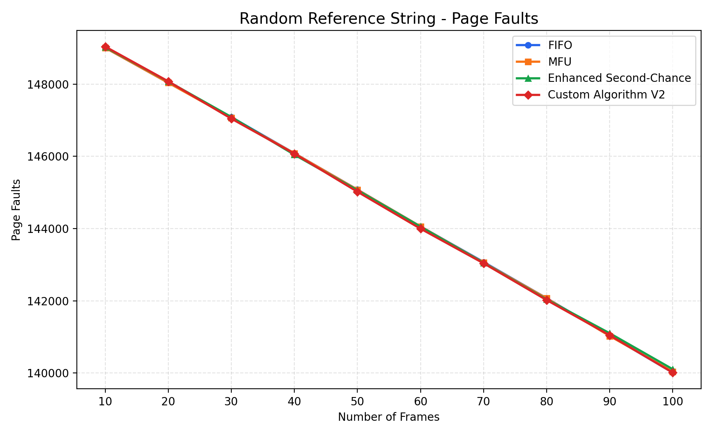
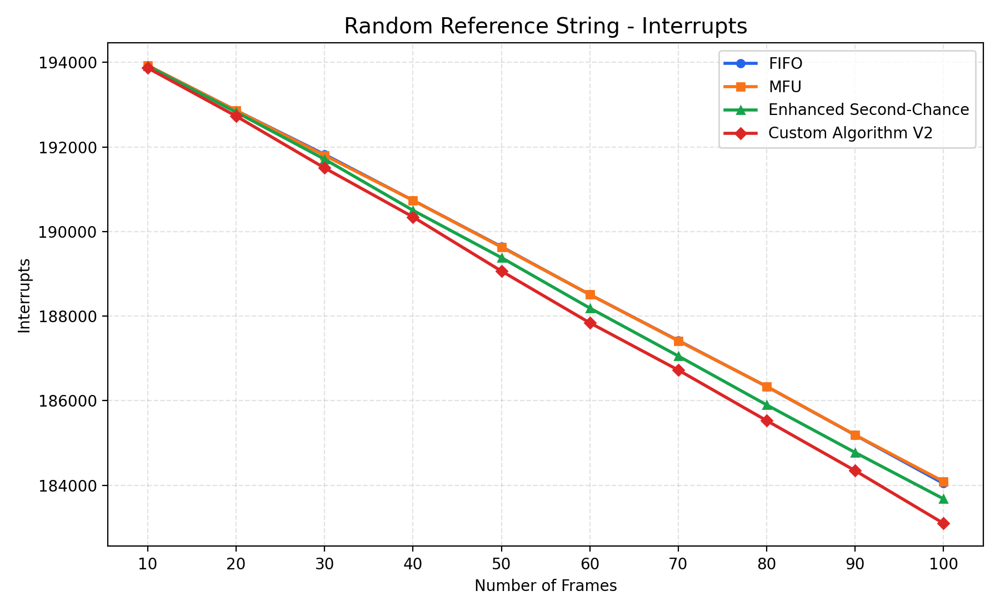
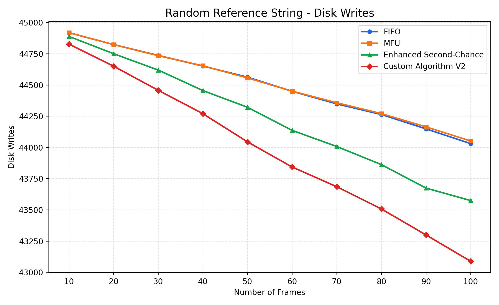
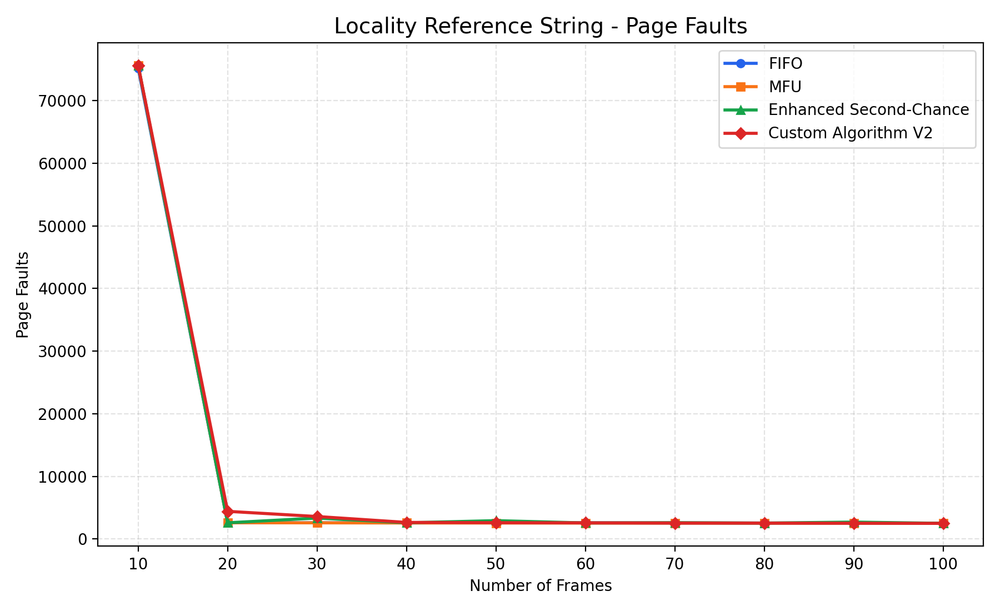
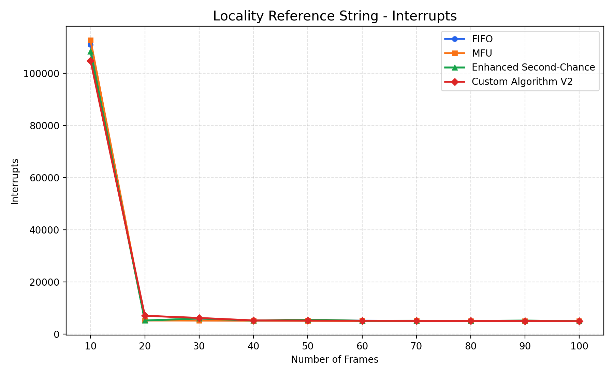
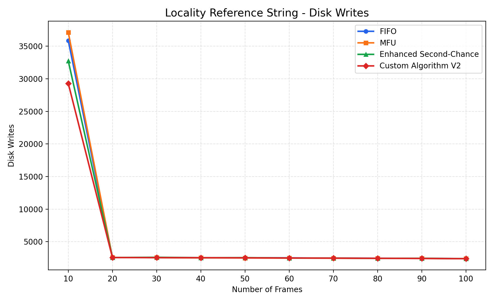
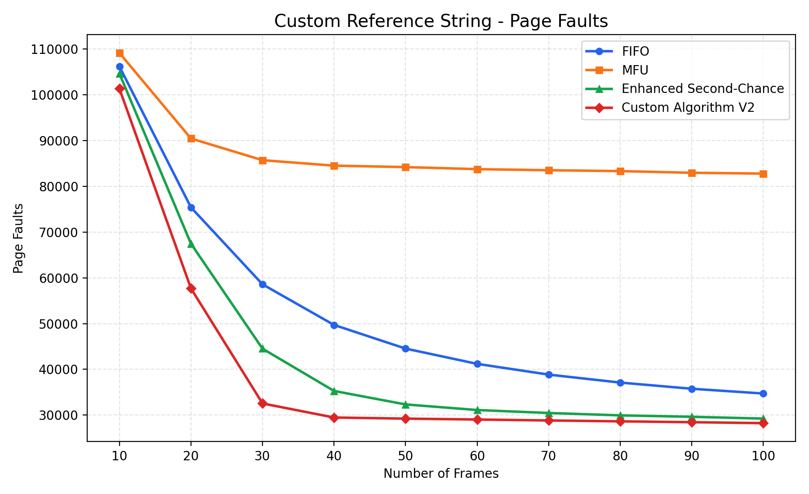
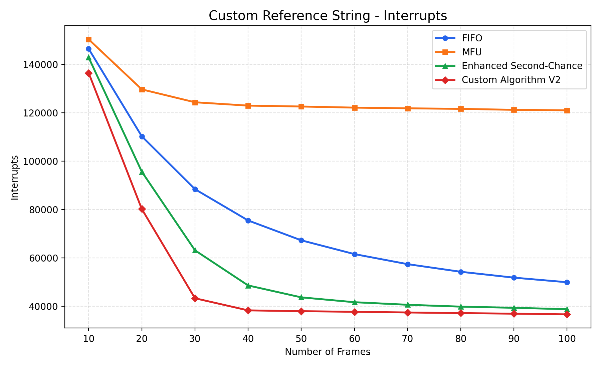
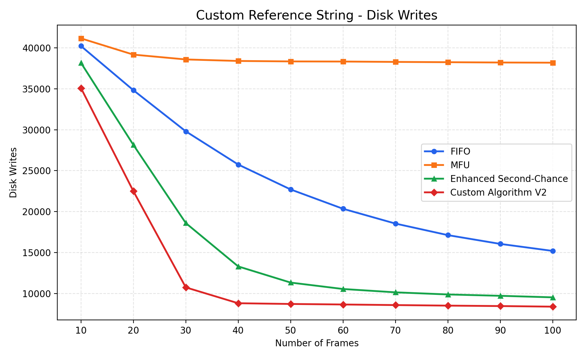

# AOS Homework 1 — Page Replacement Algorithm Simulator

> Advanced Operating Systems｜頁面置換演算法模擬與效能比較  
> **Custom Algorithm：DACR (Dirty-Aware Cost-adaptive Replacement)**

本專案使用 **Python** 模擬不同的 Page Replacement Algorithms（頁面置換演算法），比較它們在不同 **Reference Strings（頁面存取序列）** 下的效能。除了作業指定的 **FIFO、MFU、Enhanced Second-Chance (ESC)**，另外自行設計 **DACR**，嘗試在降低 **Page Faults** 的同時，減少 **Dirty Page Evictions** 所造成的 **Disk Writes**。

## Project Highlights

- **4 algorithms**：FIFO、MFU、Enhanced Second-Chance (ESC)、DACR (Custom Algorithm V2)
- **3 workloads**：Random、Locality、Custom Hotspot Reference String
- **150,000 references** per workload；Page Number 範圍為 **1–1500**
- **Frames：10、20、…、100**
- **3 performance metrics**：Page Faults、Interrupts、Disk Writes
- 自動產生實驗結果 **CSV** 與 **PNG comparison charts**，存放於 `results/`

---

## 1. Custom Algorithm — DACR

### Design Motivation

傳統頁面置換策略通常依據載入順序、使用頻率或最近使用情況來選擇 Victim Page。然而，**淘汰 Dirty Page 需要寫回磁碟**，會額外增加 I/O 成本。

因此，我設計了 **DACR (Dirty-Aware Cost-adaptive Replacement)**，把以下資訊結合到同一個淘汰決策中：

1. **Frequency（使用頻率）**：這個 Page 最近被使用多少次？
2. **Recency（近期性）**：距離這個 Page 上次被使用，已經過了多久？
3. **Dirty Bit（髒頁位元）**：如果淘汰這個 Page，是否需要 Disk Write？
4. **Write Pressure（近期寫回壓力）**：最近淘汰的頁面中，有多少比例是 Dirty Pages？

**核心概念：先保護高 Reuse Score 的 Page，再根據 Dirty-Aware Cost 選出 Victim。**

### Step 1 — Sliding Window Frequency Tracking

DACR 不會永久累積每個 Page 的使用次數，而是使用 **Sliding Window** 觀察近期的存取行為。

$$
W = 2 \times \text{Frames}
$$

- `deque`：維護最近 `W` 次 Page References。
- `Counter`：統計各 Page 在 Window 內的 **Frequency**。
- 當新 Reference 進入、Window 長度超過 `W` 時，移除最舊的 Reference，並更新對應的 Frequency。

這能減少很久以前的熱門 Page 持續影響現在的淘汰決策。**從 Sliding Window 移除一筆歷史紀錄，不代表實際把該 Page 從記憶體淘汰。**

### Step 2 — Calculate Reuse Score

DACR 會針對目前存在記憶體中的 **Resident Pages**，計算 Frequency Score 與 Recency Score。

**Normalized Frequency Score**：

$$
FreqScore(p) = \frac{Frequency(p)}{\max\left(1,\max_{q\in Resident}Frequency(q)\right)}
$$

其中 `MaxFrequency` 是**目前 Resident Pages 中**，在 Sliding Window 內出現最多的次數。

**Recency Score**：

$$
Age(p) = CurrentStep - LastUsed(p)
$$

$$
RecencyScore(p) = \frac{1}{1+\frac{Age(p)}{\text{Frames}}}
$$

**Final Reuse Score**：

$$
\boxed{ReuseScore(p) = 0.65 \times FreqScore(p) + 0.35 \times RecencyScore(p)}
$$

- **Higher Reuse Score** → 越傾向保留該 Page。
- **Lower Reuse Score** → 越可能進入 Candidate Set。

`0.65` 與 `0.35` 為本實作選用的權重參數，並非課本固定公式。

### Step 3 — Candidate Selection

為避免只為了省下一次 Disk Write，就淘汰非常熱門的 Clean Page，DACR 先篩選出 **Reuse Score 較低**的頁面。

$$
S_{min}=\min_{p\in Resident}ReuseScore(p)
$$

$$
\boxed{Candidates=\{p\in Resident\mid ReuseScore(p)\le S_{min}+0.25\}}
$$

`candidate_margin = 0.25` 是目前的設計參數。只有進入 **Candidate Set** 的 Page，才會參與下一階段的 Dirty-Aware Cost 比較。

### Step 4 — Adaptive Dirty Penalty

DACR 利用 **Global Eviction History（全域淘汰紀錄）**，觀察最近的 Page Evictions：

- `1`：Dirty Page 被淘汰，需要寫回磁碟。
- `0`：Clean Page 被淘汰，不需要寫回磁碟。

History 最多保留：

$$
H=\max(20,4\times Frames)
$$

近期寫回壓力 **Write Pressure** 定義為：

$$
P=\frac{Recent\ Dirty\ Evictions}{Recent\ Total\ Evictions}
$$

接著動態設定 **Dirty Penalty（λ）**：

$$
\boxed{\lambda=0.15+0.55P}
$$

因此，`0.15 ≤ λ ≤ 0.70`。

**Write Pressure 越高，λ 越大**，代表演算法會更加避免淘汰 Dirty Pages。同一次 Replacement 中，所有候選 Page 使用相同的 λ，但各自的 Reuse Score 和 Dirty Bit 不同。

這裡的 Write Pressure 是**近期實際 Dirty Eviction 比例**，並不是作業系統或磁碟真正量測到的 I/O 負載。

### Step 5 — Final Victim Selection

對每個 Candidate 計算：

$$
\boxed{Cost(p)=ReuseScore(p)+\lambda\times DirtyBit(p)}
$$

$$
\boxed{Victim=\arg\min_{p\in Candidates}Cost(p)}
$$

- **Dirty Bit = 0**：Clean Page，不增加 Dirty Penalty。
- **Dirty Bit = 1**：Dirty Page，Cost 額外增加 λ。
- **Tie-breaking**：若 Cost 相同，選擇 `last_used` 較早的 Page。
- 淘汰 Dirty Page 時，`disk_writes` 增加 1；淘汰後更新 `eviction_history`，供**下一次**決策使用。

**Victim Selection Example（λ = 0.425）**：

| Candidate | Reuse Score | Dirty Bit | Final Cost |
|:--|--:|--:|--:|
| Page A | 0.25 | 1 | 0.675 |
| **Page B** | **0.45** | **0** | **0.450** |
| Page C | 0.40 | 1 | 0.825 |

假設三個 Page 已通過 Step 3 的候選篩選，DACR 最後會淘汰 **Page B**：雖然它不是 Reuse Score 最低的 Page，但它是 **Clean Page**，所以在這次置換中可以避免一次 Disk Write。

> `Cost(p)` 是演算法用於選擇 Victim 的 **decision score（決策分數）**，不等於實際的 Interrupts 或 Disk Writes 次數。

---

## 2. Reference String Design

所有演算法在同一組 Benchmark 中使用**相同的 Reference String**，以確保比較公平。

| Reference String | Access Pattern｜存取模式 | Purpose｜測試目的 |
|:--|:--|:--|
| **Random** | Page 1–1500 均勻隨機存取 | 測試缺乏固定存取規律時的效能 |
| **Locality** | 模擬 Procedure Calls，集中存取局部 Page 集合，並切換工作區域 | 測試 Working Set 變動時的反應 |
| **Custom (Hotspot)** | **80%** 存取 Page 1–20；**20%** 存取 Page 21–1500 | 測試能否保留 Hot Pages 並處理偶發 Noise |

每組共 **150,000 references**，採用約 **70% Read / 30% Write** 的模擬設定。

### Why Hotspot-Based References?

這個工作負載用來模擬 **Database Cache**、**Web Server** 等可能出現「少數熱門資料頻繁被使用，其餘資料偶爾被存取」的情況。

當 Frames = 30 時，20 個 Hot Pages 理論上可以同時留在記憶體中，額外 Frames 則可以處理其他 Noise Pages。這能用來觀察演算法是否會反覆淘汰熱門頁面。

---

## 3. Experimental Setup

| Item | Configuration |
|:--|:--|
| Total References | 150,000 per workload |
| Page Range | 1–1500 |
| Number of Frames | 10, 20, …, 100 |
| Algorithms | FIFO / MFU / ESC / DACR |
| Page Faults | 參考到不在記憶體中的 Page 的次數 |
| Disk Writes | Dirty Page 被淘汰而需寫回磁碟的次數 |
| Interrupts | 本程式採用 `Page Faults + Disk Writes` 的簡化計數方式 |

> **Simulation assumption：** `Interrupts = Page Faults + Disk Writes` 是本次模擬採用的計數假設，並非所有實際作業系統都遵循的通用公式。

---

## 4. Experimental Results

### Highlight — Custom Hotspot Reference String (30 Frames)

| Algorithm | Page Faults | Interrupts | Disk Writes |
|:--|--:|--:|--:|
| FIFO | 58,585 | 88,387 | 29,802 |
| MFU | 85,722 | 124,300 | 38,578 |
| Enhanced Second-Chance (ESC) | 44,519 | 63,122 | 18,603 |
| **DACR (Custom V2)** | **32,548** | **43,298** | **10,750** |

相較於 **ESC**，在 30 Frames 的 Custom Hotspot 測試中，DACR 達到：

- **Page Faults ↓ 26.9%**
- **Interrupts  ↓ 31.4%**
- **Disk Writes ↓ 42.2%**

#### Why Are Disk Writes Lower?

這個結果可以分成兩個面向理解：

1. **Fewer Page Evictions（淘汰次數下降）**：DACR 的 Frequency + Recency 評分有助於保留 Hot Pages，使 Page Faults 減少，進而降低需要淘汰頁面的機會。
2. **Lower Dirty Eviction Ratio（Dirty Page淘汰比例下降）**：DACR 的 Dirty-Aware Cost 會影響淘汰目標，使實際被淘汰的頁面中，Dirty Pages 所占比例較低。

| Metric（30 Frames） | ESC | DACR |
|:--|--:|--:|
| Total Evictions | 44,489 | 32,518 |
| Dirty Evictions | 18,603 | 10,750 |
| Dirty Eviction Ratio | 41.82% | 33.06% |

這個比較可以解釋**觀察到的結果**，但還不能單獨證明 Dirty Penalty 的因果效果；若要獨立驗證，需額外比較移除 Dirty Penalty 的 DACR 版本（Ablation Study）。

### Performance Charts

下列圖片由 `plot_results.py` 產生，放在專案的 `results/` 資料夾中；GitHub 會直接顯示對應 PNG。

#### Random Reference String

**Page Faults vs. Frames**  

**Interrupts vs. Frames**  

**Disk Writes vs. Frames**  

#### Locality Reference String

**Page Faults vs. Frames**  

**Interrupts vs. Frames**  

**Disk Writes vs. Frames**  

#### Custom Hotspot Reference String

**Page Faults vs. Frames**  

**Interrupts vs. Frames**  

**Disk Writes vs. Frames**  

### Performance

**Random：** 各種演算法的 Page Faults 差異不大，因為均勻隨機存取缺乏穩定的 Hot Pages。DACR 的 Dirty-Aware 規則仍可能幫助減少 Disk Writes。

**Locality：** Working Set 在不同局部區域間切換；DACR 不一定全面勝出。例如 **20 Frames** 時，DACR 的 Page Faults 為 **4,419**，高於 ESC 的 **2,591**，反映其 Reuse Score 和 Dirty Penalty 在某些切換情況下可能產生取捨成本。

**Custom Hotspot：** Page 1–20 被頻繁存取，DACR 的 Frequency + Recency 有機會保留 Hot Pages，而 Dirty-Aware Victim Selection 可進一步避免部分寫回，因此在這組實驗中取得較佳結果。